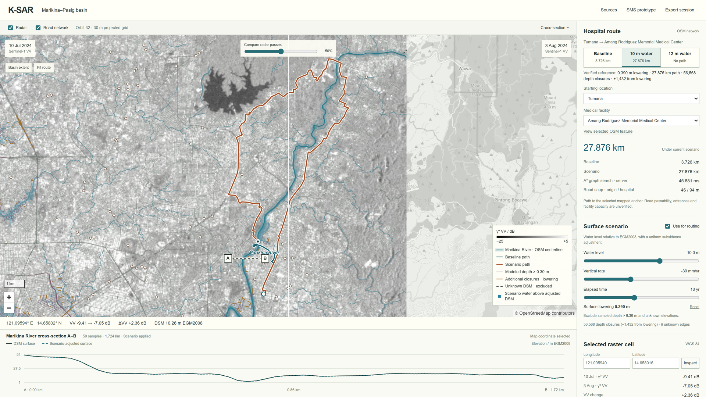

# Project K-SAR

A browser workspace for radar observations, surface-elevation scenarios and hospital-path calculations in the Marikina–Pasig basin, Philippines. Built for the 2026 NASA Space Apps Challenge (*Dancing with the SARs*).

[Open the workspace](https://k-sar.vercel.app) · [Source code](https://github.com/zLxisFX/k-sar) · [Seven-slide presentation](https://k-sar.vercel.app/Project_K-SAR_2026_Final.pdf)

K-SAR places two Sentinel-1 C-band acquisitions bracketing the July 2024 Carina event, a Copernicus GLO-30 surface model and an OpenStreetMap road graph in one inspectable map. Compare radar passes, inspect pixel backscatter and elevation values, preview surface lowering along the Marikina River profile, and calculate how an assumed water surface changes road-network connectivity to a selected hospital feature. The Sources view provides two original 2026 NASA–ISRO NISAR L2 GCOV browse images, their catalog records and coverage footprints.



The deployed 10 m scenario: a 27.876 km graph path to the selected Amang Rodriguez hospital anchor, with 0.390 m assumed surface lowering.

## Reproduce the example

Use the **Baseline**, **10 m water** and **12 m water** buttons in the route panel. Each selects Tumana and the Amang Rodriguez Memorial Medical Center OSM anchor, applies the matching inputs and recalculates the route.

| Preset | Water surface | Rate / elapsed time | Routing scenario | Reference result |
|---|---:|---|---|---|
| Baseline | 0 m EGM2008 | 0 mm/year / 13 years | Off | 3.726 km topology-only path |
| 10 m water | 10 m EGM2008 | −30 mm/year / 13 years | On; 0.390 m lowering | 27.876 km path, a 648% increase |
| 12 m water | 12 m EGM2008 | −30 mm/year / 13 years | On; 0.390 m lowering | No path to the selected anchor |

The preset's reference text is distinct from the computed result. Changing the origin, hospital, water level, rate, elapsed time or routing toggle removes the preset selection unless the controls exactly match another preset. **Custom inputs** remain editable; with **Use for routing** off, surface preview changes do not apply flood exclusions to the graph.

The 10 m scenario has 55,136 depth-closed directed edges without lowering and 56,568 with 0.390 m lowering: **1,432 additional closures**. The amber layer contains 803 unique geometries associated with those 1,432 newly excluded directed edges. Six edges with incomplete DSM coverage are excluded separately. The 27.876 km path is the same with and without lowering at this water level.

These calculations screen graph connectivity using an assumed water surface and a DSM. They do not establish observed flooding, road passability, hospital operation or isolation from every hospital.

## Run locally

Use Node.js 20 or later, npm and Python 3.11 or later. Package versions and the npm lockfile are pinned.

```sh
npm ci
npm run dev
```

Open <http://127.0.0.1:3000>. To check and build:

```sh
npm run typecheck
npm test
npm run build
npm start
```

The servers bind to loopback by default. The committed data supports local calculations and offline data verification; the contextual OpenStreetMap background tiles require a network connection.

## Data

| Source | Included material | Use |
|---|---|---|
| Sentinel-1 RTC | Orbit 32, descending, 10 July and 3 August 2024; VV/VH Float32 TIFFs | Radar comparison and coordinate samples |
| Copernicus GLO-30 | DSM aligned to the radar grid; elevations in m EGM2008 | Surface profile and scenario screening |
| OpenStreetMap | 62,446 nodes, 155,830 directed edges, 215 hospital-tagged features and contextual waterways | Graph search and map context |
| NASA–ISRO NISAR | L2 GCOV catalog records, original browse PNGs and footprints for 21 October and 2 November 2026 | Inspectable mission observations and provenance |

The Sentinel-1 TIFFs contain gamma-naught values already converted to dB on an aligned **854 × 998** grid. Each band has **852,292 finite pixels**. Grid spacing is 30 projected metres in EPSG:3857. At the Tumana reference coordinate (`121.095940° E, 14.658016° N`), VV shifts from `−9.41 dB` on 10 July to `−7.05 dB` on 3 August (`+2.36 dB`). Because the acquisitions are 24 days apart and do not capture the July 2024 flood peak, backscatter change is distinguished from water depth.

The NISAR pair shares ascending track 140 and frame 009, twelve days apart. The browse files are checked against the provider's PNG checksums. Their colors are visual references; quantitative GCOV HDF5 pixels have not been downloaded or analyzed, and the differing footprints are not registered for pixel subtraction. These 2026 observations do not depict the 2024 Carina event.

### Why C-band and L-band

Sentinel-1 uses **C-band, approximately 5.6 cm wavelength**; NISAR L-SAR uses **L-band, approximately 24 cm**. Longer-wavelength radar generally penetrates farther into vegetation, although canopy density and target geometry affect the response. This motivates testing NISAR for surface change beneath vegetation alongside the Sentinel-1 observations. It does not establish a universal flood threshold or make the two sensors' backscatter directly interchangeable. K-SAR currently compares quantitative Sentinel-1 values and displays NISAR browse references; quantitative L-band HDF5 analysis is the next validation stage. Sources: [ESA Sentinel-1 tutorial](https://step.esa.int/docs/tutorials/S1TBX%20Landcover%20classification%20with%20Sentinel-1%20GRD.pdf), [NASA NISAR fact sheet](https://www.earthdata.nasa.gov/s3fs-public/2025-01/HR_NA_NISAR_Nov2024.pdf), [NASA SAR Handbook, chapter 2](https://earthdata.nasa.gov/s3fs-public/2025-04/SARHB_CH2_Content.pdf).

The [raster manifest](data/sentinel-1/manifest.json), [network manifest](data/network/manifest.json), [transect reference](data/transect/reference.json) and [NISAR documentation](data/nasa/nisar/README.md) retain file hashes and source details. The 59-point transect spans 1.724 km on the WGS84 ellipsoid.

## Calculations

Surface lowering uses:

```text
z_model = z_DSM − abs(rate_mm_per_year) / 1000 × elapsed_years
```

At −30 mm/year over 13 years, the modeled change is −0.390 m. Rate and elapsed time are user inputs, not a measured InSAR velocity field or an exact acquisition epoch. GLO-30 is a surface model that includes buildings and vegetation.

Each road edge is sampled at its vertices and at intervals of at most 15 projected metres. The minimum sampled DSM elevation is lowered by the selected amount. An edge is excluded when modeled depth is strictly greater than 0.30 m; any missing DSM sample excludes the edge as unknown. Water and surface elevations share the EGM2008 vertical reference. Bridges, flood barriers, water connectivity and surveyed road-deck heights are not modeled.

Conventional A* minimizes original OSM edge lengths using an admissible scaled Euclidean heuristic in EPSG:32651. Origins and hospital features are snapped to graph nodes; snap distances are reported. Hospital-tagged features can duplicate a facility and do not verify entrances, capacity or operation.

The surface preview and routing scenario are independent. **Use for routing** applies the selected water level, rate and elapsed time. Pending calculations remain distinguishable from applied results.

## API and session export

`GET /api/route` returns the origin and hospital catalog. `POST /api/route` accepts:

```json
{
  "origin": [121.09593983925672, 14.6580158],
  "hospitalId": "way/54025002",
  "scenario": { "waterLevelM": 10, "rateMmYear": -30, "elapsedYears": 13 }
}
```

Use `scenario: null` for the topology-only result. Responses preserve the applied request, graph identity, path geometry, search timing and separate depth-closure and unknown-coverage counts.

Session JSON uses schema 2. It records **17 file identities and SHA-256 hashes**, map position, layer visibility, the selected coordinate/profile index, surface preview, requested route, applied response and pending state. The file identifies the source rasters and profile rather than embedding every source pixel; external background tiles are outside its hash coverage.

The SMS panel is a local acknowledgement simulator. It validates GSM-7 requests and returns a fixed reply of exactly 145 characters and septets. It has no gateway, transmission or dispatch integration.

## Verification and benchmarks

The current suite has 47 passing tests: 35 Node.js tests and 12 Python tests. It checks raster decoding and alignment, real pixel samples, geodesic transect distances, the lowering equation, strict depth boundaries, unknown coverage, graph-search correctness, route examples, presets, session state, GSM-7 encoding, streaming transport and the pinned NISAR metadata/browse bundle. These are software and data-contract checks, not field validation of floodwater or access.

```sh
python scripts/import-nisar.py --verify
npm run benchmark:routing
```

The benchmark records 30 graph-search runs after ten warmups. [benchmark-current.json](data/network/benchmark-current.json) retains the runtime, every timing and graph hashes. Its 14 November Node.js run measured Tumana baseline at 0.1654 ms median and the 10 m detour at 3.7931 ms median. Search timing includes allocation and path reconstruction; it excludes graph loading, snapping, scenario preparation, geometry and HTTP. Live timings vary.

Running `scripts/import-nisar.py` without `--verify` downloads the pinned public NASA metadata and browse files again. Running the application and tests uses the checked graph and raster manifests bundled in `data/`.

## Architecture and deployment

- `src/components/`: MapLibre workspace, radar curtain, river profile and NASA reference viewer.
- `src/domain/`: raster sampling, elevation, graph search, SMS encoding and session serialization.
- `src/server/` and `src/app/api/route/`: graph loading and route responses.
- `data/`, `scripts/` and `tests/`: source assets, import records, reproduction and checks.

Before development, build or production start, `prepare:assets` copies an explicit list of source files into `public/data/` and verifies the copied bytes. The pinned MapLibre worker is copied to `public/maplibre/`. Both generated directories are ignored by Git.

For Vercel, `vercel.json` runs `npm run build`; large TIFF/GeoJSON assets are static. The routing function streams plain JSON and leaves transport compression to Vercel.

## Sources and attribution

See [data/NOTICE.txt](data/NOTICE.txt) for dataset attribution and licenses, and [data/network/NOTICE.txt](data/network/NOTICE.txt) for OpenStreetMap/ODbL terms.

The [Dancing with the SARs challenge](https://www.spaceappschallenge.org/2026/challenges/dancing-with-the-sars/) motivates the multi-frequency NISAR and Sentinel-1 inspection workflow. Quantitative NISAR change analysis and field comparison are the next validation steps.

Original software is licensed under [Apache License 2.0](LICENSE). Third-party data and dependencies retain their own licenses.

## Session source hashes

All 17 files were fetched anonymously from the production alias on 15 November 2026 and matched these local SHA-256 digests.

| # | Dataset ID | Bytes | SHA-256 |
|---:|---|---:|---|
| 1 | `sentinel-1/baseline.tif` | 6,153,533 | `0f035f4b14488d27c45c7d88744503b23c12ac32f6145b1b1af56006115475f4` |
| 2 | `sentinel-1/post.tif` | 6,147,415 | `24473d762dcd2de5dbf227e3d0ce043b32b3d46f4ce767076cda1e21e5e21f0c` |
| 3 | `sentinel-1/dem.tif` | 2,561,258 | `39ee1d9afa27ffbf5a552566253e646a740416c3b86cac61db79209dbaec2a86` |
| 4 | `network/graph.json.gz` | 8,001,173 | `187a0e0fb4929b4ef5e092a76d43bcf76c179f622659887baa5c7497af7380b2` |
| 5 | `network/hospitals.geojson` | 106,810 | `cb8398481f67381f2a9d2c604325d4f9ed9b9c0aa63caf1f51ed0e9b5691db83` |
| 6 | `network/roads-display.geojson` | 16,179,717 | `3ee78a19b59672fa90c287cdff7693139d98f9582fe7c3451f29f94ddb7d3e4b` |
| 7 | `network/source-osm-manifest.json` | 561 | `275a06719e32d4523cda4581edd8d9ece0be7a03bb710a3463a41fb87f7aa711` |
| 8 | `network/source-terrain-manifest.json` | 1,049 | `d63ce525ab23df671e1deb380d643dae46c60c4550d661097b3ec8c97b35855b` |
| 9 | `network/odbl-1.0.html` | 51,543 | `85bc21fb2c00b2effb9202b2aa785934ce5a05df954e17cbd2a1f7c10c04c633` |
| 10 | `network/waterways.geojson` | 2,381,373 | `eca79db5e7d29d8efcd05770b39e18b30afb5845b813640c5e5c8fc73b5111df` |
| 11 | `transect/reference.json` | 23,416 | `848bc873ac998406b7287a4b54a7ba7d413d2d7780b6fa8d5b73bdd97117ab8e` |
| 12 | `nasa/nisar/browse/2026-10-21.png` | 3,577,844 | `28b5d11fe4953b81ec0c82ae5c0512894ef2a5550afbffced8c5b7da385cb5bf` |
| 13 | `nasa/nisar/raw/G4404197169-ASF.umm.json` | 29,124 | `870955a73ab5ac97dbddeca674d2483c59d3602a517dfe6730ce5aecc5bffe27` |
| 14 | `nasa/nisar/browse/2026-11-02.png` | 3,461,930 | `066d77b8f38fbc0b03edf65727ff1647f0db6e58898f53544173dc5008b78289` |
| 15 | `nasa/nisar/raw/G4408731464-ASF.umm.json` | 29,120 | `6a95424ba69fe1affaf0e5ae28479c6cebebd14569fa99598694b449b1cc8200` |
| 16 | `nasa/nisar/raw/C3622241360-ASF.umm.json` | 10,704 | `616216cbc19bbf9f16b70ac4b6c063b993f4d966007a3a26c7ee7259598bc256` |
| 17 | `nasa/nisar/footprints.geojson` | 1,710 | `d96bf5c72628cfc01512c9b0a00b8cd6aa7b3d074fb60600d260b183389eca2a` |
